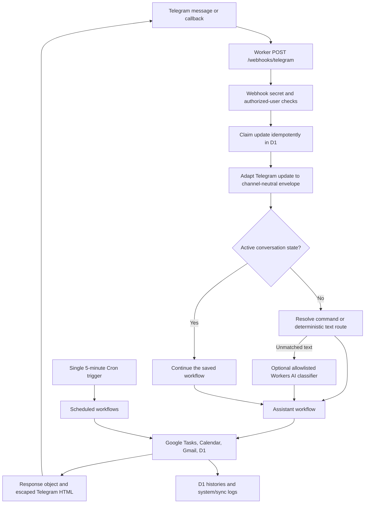

# Personal Productivity Assistant

This README is the as-built guide for the Cloudflare implementation in this
directory. It documents the product model, request and callback flow, Telegram
message conventions, user workflows, schedules, data model, source tree,
configuration, and known limitations.

> **Architecture notice:** the running application is a Cloudflare Worker with
> D1. It is not the former Google Apps Script + Google Sheets implementation.
> The Apps Script deployment was deleted and cannot be used for rollback. The
> original Google Sheet remains unchanged as an archive; its data was not
> imported into D1.

## 1. Product concept and rules

The assistant is a private, single-user productivity and accountability tool.
Telegram is its interactive interface. It helps the user capture tasks, choose
daily outcomes, review goals, plan focus sessions, review unread email, and
record manual accountability check-ins. Google services are integrations, not
places for the assistant to make unconfirmed decisions.

| Information or action | Authority / behavior |
| --- | --- |
| Task status and due date | Google Tasks is authoritative. D1 keeps a synchronized mirror and history. |
| Conversations, workflow state, goals, reviews, logs, reminders | Stored in D1. Conversation state has an expiry; histories are retained. |
| Calendar availability | Read from Google Calendar when enabled. The assistant does not infer a user's normal work hours. |
| Calendar event creation | Only after a user explicitly starts the task-scheduling action and chooses a Cairo-local start and 25- or 50-minute duration. Availability plans are advisory and never create events. |
| Gmail inbox | Read-only triage. Messages are not marked read, replied to, or sent by inbox analysis. |
| Gmail reports and escalations | Sent only by their separately enabled scheduled workflows and configured recipient. |
| Trello and Obsidian | Manual check-ins only; neither API is called. |
| Completion or cancellation | Never inferred from a reminder, plan, elapsed focus block, or delivery receipt. Completion requires an explicit user action. The app does not automatically cancel tasks. |
| Time zone | `Africa/Cairo` for date keys, schedule windows, deadlines, and user-entered local times. |

Other invariants:

- A Telegram message being delivered is not evidence that a task or outcome is
  complete.
- Task synchronization mirrors Google Tasks; it must not silently replace
  Google's status with a D1 value.
- A task is completed in Google Tasks first, and its D1 mirror is updated only
  after that operation succeeds.
- Planning recommendations do not imply task duration, available work hours,
  or a booking.
- D1 records include Telegram message text, workflow data, task metadata, and
  review history. Gmail bodies and AI email analyses are transient and are not
  persisted.
- OAuth credentials, bot credentials, webhook secrets, and other secret values
  belong in Cloudflare Worker secrets. Never put them in source, D1, this
  README, or chat.

## 2. Architecture and request flow



### Inbound Telegram update

1. The Worker accepts `POST /webhooks/telegram`. `GET /health` reports the
   deployment stage, assistant gate, traffic gate, and D1 binding presence.
2. The webhook secret header is checked, then the update's Telegram user ID is
   compared with the authorized user ID.
3. Unsupported users are ignored. Supported updates are adapted in
   [`src/channels/telegram.js`](src/channels/telegram.js) to a neutral envelope
   containing update, user, conversation, message, and optional action IDs.
4. The Worker claims the update in D1. Unique update/action/message identities
   prevent duplicate processing on Telegram retries.
5. Callback queries are acknowledged before their business action runs.
6. If a conversation state is active, ordinary text continues that workflow
   before natural-language classification. Otherwise, a command or
   deterministic text route is selected. Workers AI classification is optional
   and can only return an allowlisted intent; it cannot execute an action.
7. The assistant invokes the necessary repository or Google integration and
   returns a response model. The Worker sends it, records delivery/action
   metadata, and marks the update processed.
8. Errors are logged with bounded/safe details. If possible, Telegram receives
   an explicit notice that the action needs attention. Ambiguous writes are not
   automatically retried.

### Scheduled update

There is one Cron trigger, every five minutes. It calls
[`src/scheduled.js`](src/scheduled.js), which evaluates Cairo-local schedules
and invokes focus follow-ups, daily rhythm prompts, reports, escalations,
Calendar reminders, and task reminders. Each workflow has its own idempotency
record or deduplication key where applicable. A failed email-escalation cycle
is logged and returned as a failed result so it does not abort later reminder
work.

## 3. Telegram response model and visual format

Assistant flows return a channel-neutral object:

```js
{
  category: "Task capture",
  title: "Choose priority",
  sections: [
    { heading: "Draft the proposal", lines: ["WORK"] }
  ],
  actions: [
    [
      { label: "High", action: "task_priority|High" },
      { label: "Medium", action: "task_priority|Medium" }
    ]
  ]
}
```

The fields are:

- `category`: classification stored with the outgoing message.
- `title`: optional main heading.
- `sections`: ordered groups of a heading and one or more lines.
- `actions`: inline-keyboard rows. Each inner array becomes one row of buttons.
  Button callback data is an internal action identifier, not free-form code.
- `inputMode: "force_reply"` and `inputPlaceholder`: ask Telegram to prompt for
  a text answer instead of rendering inline buttons.

[`src/channels/telegram-api.js`](src/channels/telegram-api.js) formats the
object as Telegram HTML:

```text
<b>{title}</b>

<b>{section heading}</b>
{line 1}
{line 2}
```

Blank titles/headings are omitted, sections are separated by a blank line, and
dynamic title/heading/line content is HTML-escaped. The client sets
`parse_mode: "HTML"`. A force-reply object becomes Telegram's `force_reply`
markup; actions become an inline keyboard. The client only retries a Telegram
HTTP 429 once when the server supplies a short retry delay. Other uncertain
send failures are not retried automatically.

### Message templates

The following are the current template shapes. Values in braces are filled from
the current user, D1, or Google API result.

**Daily home and morning briefing**

```text
Good morning.

Your three outcomes
1. DEEP — {outcome or "Not set yet"}
2. WORK — {outcome or "Not set yet"}
3. LIFE — {outcome or "Not set yet"}

Must do today · overdue or due by {Cairo date}
{pending tasks due on/before date, or an explicit empty-state sentence}

Should do today · high priority, goal-linked, or repeatedly postponed
{strategic pending tasks, or an explicit empty-state sentence}

Can wait
{other pending tasks, or an explicit empty-state sentence}

Goal-aligned next actions
{goal level, title, measured progress/deadline, and next action}

Today's calendar
{Cairo-local events, or a clear unavailable/empty message}

What do you want to move forward now?
```

The morning message offers `Start DEEP`, `Start WORK`, `Start LIFE`, `Add
something`, `Show full plan`, and `Review goals`. The manual `/today` view uses
the same task/outcome concepts and includes Calendar events when Calendar reads
are enabled. If synchronization fails, stale task details are not presented.

Task priority sections are deterministic: overdue/due-by-date first, then high
priority, active-goal-linked, or repeatedly postponed tasks, then lower-priority
tasks. Each section displays at most three tasks. The plan scans at most 100
pending tasks and reports when the candidate cap is reached. Counts are not
time estimates.

**Guided task capture**

```text
Add a task
What is the next action you want to capture?

Choose area: DEEP | WORK | LIFE | Admin | Other
Choose priority: High | Medium | Low
When is this due? Today | Tomorrow | No deadline
What would count as done?
Add this to today's Top 3? Yes | No
```

The final Top 3 question is asked only for DEEP, WORK, or LIFE. The created
Google Task stores the area and done-test in its notes. The assistant mirrors
the task in D1 and offers `Schedule focus time` only when Calendar writes are
enabled. If task creation has an ambiguous result, a D1 request marker is used
to reconcile before any retry; the app does not create a duplicate blindly.

**Goal interview**

The conversation starts with:

```text
Create a goal
What is one meaningful objective you want to work toward?
I will not invent goals for you.
```

It then asks for the horizon (life vision, annual, quarterly, monthly, weekly),
an optional parent, category, optional project, description, why it matters,
observable target, optional deadline, one or more measurable key results, and
the next action. Key results use:

```text
Measure | baseline | target | unit
Example: Weekly workouts | 0 | 3 | sessions.
```

Before saving, the assistant displays a complete summary and requires `Save
objective` or `Cancel`. A goal is not created from a classifier suggestion.
Progress updates require a user-entered numeric measurement and append history.

**Focus start and result**

The user starts a DEEP/WORK/LIFE outcome. If it is not defined, the prompt is:

```text
Set your {area} outcome
What does done look like, and when will you do it?
```

The assistant asks for the smallest visible next action, then offers 25- or
50-minute focus buttons. A focus-session response is sent around the selected
duration. It presents `Done`, `Partly done`, `Blocked`, and `Reschedule`.
`Blocked` asks which blocker applies; `Reschedule` asks for a new due date.
Only the explicit `Done` choice can complete a linked Google Task. Partial,
blocked, and dropped outcomes do not complete or cancel the task.

**Calendar task block**

```text
Choose when to work on it
Reply with a Cairo-local start time: YYYY-MM-DD HH:mm

Choose a focus duration: 25 minutes | 50 minutes
```

The Worker validates the time is in the future, creates the event with a stable
idempotency key, records the D1 block, and leaves Google Tasks status pending.
No event is created just because a task has a deadline or appears in a plan.

**Variable availability plan**

Accepted examples include `I have two hours free`, `I've got 90 minutes
available`, and `/available 90`. The assistant asks for a whole-number duration
when omitted and then asks:

```text
When does your free time start?
Enter today's start time in Cairo as HH:MM.
```

Durations are limited to 25–360 minutes in one Cairo-local day. Past times,
windows crossing midnight, Calendar conflicts, and Calendar read failures do
not produce an unverified plan. The assistant syncs Google Tasks after checking
Calendar, ranks up to three pending task candidates with Workers AI when
enabled, and falls back to repository ordering otherwise. It suggests 25/50
minute sessions and breaks, leaving spare time as buffer. It neither creates
Calendar events nor changes a task.

**Scheduled work prompts**

At 2:15 PM Cairo:

```text
2:15 PM work pre-shift
What is your SDR target for this shift?
```

It follows with:

```text
What is your hypothesis for reaching that target?
What is one learning question to test during the shift?
```

At 11:00 PM:

```text
11:00 PM shutdown
Capture open loops in Google Tasks, or confirm there are none.
Tomorrow's guided planning starts at 11:20 PM.
```

At 11:20 PM, the five-step next-day interview asks:

1. `What got DONE today?`
2. `What is the one DEEP growth outcome?`
3. `What is the one WORK / SDR outcome?`
4. `What is the one LIFE health or admin outcome?`
5. `What is the main RISK that could derail the day?`

The final step syncs Google Tasks and creates three linked tasks for tomorrow.
It records DONE and RISK as review notes, recovers uncertain creates using
stable request markers, and explicitly says Calendar blocks were not created.
The 11:40 PM confirmation offers `Confirm today's plan` or `Review today's
plan`.

**Calendar appointment reminder**

```text
Upcoming appointment

Prepare for your upcoming appointment
{HH:mm} · {event title}
Starts in about {minutes} minutes. Take a moment to prepare.

[Prepared] [Dismiss]
```

Only timed events are reminded. Delivery is deduplicated and the chosen
response is recorded; a reminder is not proof of attendance or task completion.

**Overdue-task reminder**

```text
A quick check on overdue tasks

Google Tasks still lists these as pending
{task title} · overdue since {date} · {priority}
Choose Done only after completing a task, or Later to defer this reminder for today.

[Done · task] [Later · task]
```

`Done` updates Google Tasks through the explicit completion workflow.
`Later` only defers that reminder. A failed Google Tasks refresh sends no stale
task list.

**Gmail inbox triage**

Each listed message uses:

```text
From: {sender}
Subject: {subject}
Received: {Cairo-local timestamp}
```

When AI analysis is enabled, potential follow-ups show an action label and
verbatim evidence from the email. Each suggestion offers `Create follow-up
task` and `Not now`. The closing text states that messages were not marked read
or sent and that task creation is advisory until the user taps its button.

**Weekly and monthly email reports**

Reports are plain-text Gmail messages. The weekly report contains the period,
created/completed/open/overdue counts, postponements, planning consistency,
manual Trello/Obsidian rates, accountability score, ignored reminders,
repeated postponements, missed responsibilities, goal progress, up to five
next-week task suggestions, and any bounded AI-ranked recommendations. Monthly
reports add task completion rate and project decisions. Suggestions are not
Calendar bookings.

## 4. Telegram command reference

| Command | Behavior |
| --- | --- |
| `/start`, `/today` | Daily home: sync Google Tasks, show three outcome areas, prioritized task groups, goal-aligned next actions, and Calendar events if enabled. |
| `/tomorrow` | Read-only plan for tomorrow, including outcomes, pending task priorities, goal focus, and Calendar events. |
| `/help` | Lists available controls and the main inline actions. |
| `/tasks` | Syncs Google Tasks and shows up to eight pending tasks grouped by overdue, due today, upcoming, and no deadline. Up to five completion buttons are shown. |
| `/overdue` | Syncs Google Tasks and shows up to 20 currently pending overdue tasks; up to five have completion buttons. |
| `/addtask` | Starts the guided task-capture conversation. |
| `/focus` | Lists today's outcomes and lets the user start a focus sprint. |
| `/available [minutes]` | Asks for duration if missing, then a Cairo-local start time; validates against Calendar and suggests an advisory task plan. |
| `/inbox` | Reviews up to five unread inbound Gmail conversations. Read-only; no send or mark-read action. |
| `/goals` | Lists active objectives with level, progress, deadline, and next action. |
| `/goal` | Starts the user-authored goal and key-result interview. |
| `/accountability` | Shows today's manual Trello and Obsidian check-ins and asks for explicit Done/Not done confirmation. |
| `/weekly` | Starts the five-question weekly reflection. |
| `/monthly` | Records a project decision, reason, and future review date. The user manually mirrors it in Trello. |

`progress`, `review`, `capture`, `habits`, and `settings` are recognized as
command names but do not currently have implemented workflows; they return a
migration-status response. Do not treat command recognition as feature
availability.

### Natural-language routing

The deterministic router handles the supported phrasings for daily planning,
tomorrow planning, open/overdue tasks, unread inbox, accountability, goals,
weekly review, task capture, and help before asking Workers AI. Availability
phrases are parsed deterministically and do not depend on AI.

If enabled, the classifier may return only: `today`, `tomorrow`, `tasks`,
`inbox`, `accountability`, `goals`, `goal`, `weekly`, `monthly`, `focus`,
`addtask`, `help`, or `unknown`. It only selects an existing flow; it does not
create a task, complete a task, send email, book Calendar, or save a goal.
Unsupported text receives a safe generic response.

## 5. End-to-end user workflows

### 5.1 Daily plan, outcomes, and focus sessions

1. `/today` synchronizes the configured Google Task list before displaying
   task status.
2. The deterministic planner groups pending tasks into:
   - **Must do:** overdue or due on/before the plan date.
   - **Should do:** high priority, linked to an active goal, or postponed at
     least three times.
   - **Can wait:** other pending tasks.
3. The user can set or start a DEEP, WORK, or LIFE outcome. Starting an
   existing outcome asks for a concrete next action and a 25/50-minute sprint.
4. Focus sessions are persisted in D1 and a scheduled follow-up asks for an
   explicit result. Follow-ups older than 30 minutes are expired rather than
   replayed after downtime.
5. User results are append-only outcome history. A `Done` response can complete
   a still-pending linked Google Task, after checking Google Tasks. `Partial`
   and `Blocked` do not. Rescheduling changes a pending task's Google Tasks due
   date only after the user enters a new date. Dropping an outcome requires a
   reason and leaves the linked task pending.

### 5.2 Task capture and completion

`/addtask` records title, area, priority, deadline choice, and a user-defined
done-test. For DEEP/WORK/LIFE it asks whether to add the task to today's Top 3.
Google Tasks is written first; D1 stores the Google Task reference and
synchronization history. Optional Calendar scheduling appears only after
successful creation and only if write access is enabled. No task is auto-
completed or auto-cancelled.

Completion actions re-check the D1 mirror's pending status, update Google Tasks
first, then update the D1 mirror and task history. A reminder or focus-session
delivery alone never closes a task.

### 5.3 Calendar

Daily plans and briefings read events for the correct Cairo-local date. Calendar
read failures are logged and shown as unavailable rather than as an empty
calendar. A failed availability check fails closed.

Task-to-Calendar booking is a distinct, user-triggered action:

1. Select `Schedule focus time` from an eligible task.
2. Enter `YYYY-MM-DD HH:mm` in Cairo time.
3. Select 25 or 50 minutes.
4. The Worker validates the future start and uses an idempotency key when
   creating the event.

Availability planning and task priorities never create Calendar events.
Mini App date/time selection is not migrated and is not required for the text
conversation flow.

### 5.4 Goals and measurable progress

Goals are user-authored and can be hierarchical across life vision, annual,
quarterly, monthly, and weekly levels. Optional project names are recorded as
references; no Trello API is called. Each goal has a reason, observable target,
optional deadline, next action, and measurable key results. Save requires
explicit confirmation. Parent links and task links do not change task status.
Progress is numeric, user-entered, and append-only.

Daily plans and briefings show goal-aligned next actions. Weekly/monthly reports
summarize the measured values and number of progress updates; goals are never
marked achieved automatically.

### 5.5 Weekly and monthly review

`/weekly` saves five text answers as review notes:

1. On how many days were DEEP, WORK, and LIFE outcomes completed, and which
   areas felt clear?
2. What repeatedly blocked progress? Name a pattern, not a judgment.
3. Which open loop should be deleted, delegated, or scheduled?
4. What is one small experiment for next week?
5. Which project needs a continue, change, pause, or kill decision?

After saving, the user can open unfinished tasks or review a project.

`/monthly` asks for a project, a Continue/Change approach/Pause/Kill choice, a
reason, and a future `YYYY-MM-DD` review date. It records the decision in D1 and
reminds the user to enter it manually in Trello.

Scheduled reports are separate from guided reviews: Friday 18:00 Cairo creates
the weekly snapshot; 18:00 on the first of a month creates the previous-month
snapshot. A scheduled Gmail report is not sent by `/weekly` or `/monthly`.

### 5.6 Gmail inbox and reports

The inbox searches unread messages without requiring the `IMPORTANT` label or
a recent-date filter, includes archived messages, and selects the latest unread
inbound message per thread. Gmail's own search excludes Spam and Trash.

When the independent read and AI-analysis gates are enabled, up to five
messages are fetched as bounded plain text: at most 100 KB fetched per message
and at most 2,500 extracted characters passed for analysis. The AI output must
refer to supplied message IDs and exact evidence. Bodies and analyses are not
persisted. Suggestions require a button tap before creating a Google Task; no
deadline is inferred.

Gmail report delivery and inbox reading use separate gates and Google scopes.
The inbox is read-only. Report and escalation email sends are scheduled,
separately enabled operations.

### 5.7 Manual accountability

`/accountability` presents Trello and Obsidian check-in status for today's Cairo
date. A button tap records Completed or Missed. At most one current record per
routine/date is maintained; check-ins are user-confirmed. Trello and Obsidian
are never queried or edited through APIs and these check-ins do not trigger
automated notifications.

### 5.8 AI recommendations and limits

Workers AI is used for:

- Allowlisted natural-language intent classification.
- On-demand daily task ranking.
- Evidence-backed weekly/monthly recommendation ranking.
- Bounded Gmail follow-up analysis.
- Availability-plan task ranking when the feature gates are enabled.

The daily focus suggestion can be accepted or rejected explicitly. Recording a
decision does not change task status, due date, or Calendar. If AI is disabled,
over budget, unavailable, or returns invalid data, the existing deterministic
flow remains available and does not invent an action.

AI features use the configured model allowlist, bounded prompts/outputs, and a
shared D1 daily usage ledger with a 5,000-neuron internal budget and 9,000
hard maximum. The ledger cannot see other Workers AI consumers in the
Cloudflare account; account-level usage must be monitored separately.

## 6. Scheduled jobs and timing

The Worker Cron expression is `*/5 * * * *`. The handler checks local time in
`Africa/Cairo`; it does not send every listed message on every Cron invocation.

| Cairo time / cadence | Workflow |
| --- | --- |
| 7:30 AM daily | Morning briefing: outcomes, synchronized task plan, goals, Calendar, and overdue overview. It replaces a separate overdue digest. |
| 2:15 PM daily | Three-question work/SDR target, hypothesis, and learning prompt. Weekend pre-shift is skipped. |
| 15 minutes before timed Calendar event | Appointment reminder within the 10–15 minute detection window; deduplicated, maximum five per run. |
| 11:00 PM daily | Shutdown/open-loop prompt. Weekend shutdown is skipped. |
| 11:20 PM daily | Five-question next-day planning interview. |
| 11:40 PM daily | Single planning confirmation with confirm/review buttons. Legacy 00:00/00:20/00:45 checkpoints remain compatibility checks. |
| Friday 6:00 PM | Weekly D1 snapshot and Gmail report, when integrations/recipient are configured. |
| First day of month, 6:00 PM | Previous-month D1 snapshot and Gmail report. |
| Every even Cairo hour at `:00` | Check eligibility for high-priority email escalations. |
| Every five minutes | Process due focus-session follow-ups; stale ones are expired. |

Email escalation requires all of the following: the feature is enabled, Google
Tasks and Gmail are configured, a recipient is configured, the task remains
pending in Google Tasks after sync, it is High priority and overdue by at least
the configured threshold (24 hours by default), and at least one prior reminder
is recorded. At most five escalations are attempted per run. Sent, failed, and
uncertain outcomes are tracked to prevent duplicate sends. A failed cycle is
logged and returned as a failure result; independent reminder workflows
continue. Never trigger a production test email or manufacture an eligible
task to validate delivery.

## 7. Data model and migration history

D1 is the operational database. Current state may be upserted, while
task/outcome/goal-progress histories and logs record changes. The table
definitions and constraints are authoritative in the migration SQL.

### Core records in `0001_initial.sql`

- Identity and conversations: `users`, `conversations`,
  `channel_updates`, `channel_messages`, `channel_actions`.
- Google Tasks mirror and append-only history: `tasks`, `task_history`.
- Daily outcomes and notes: `daily_outcomes`, `review_notes`.
- Accountability and reminders: `accountability_routines`,
  `accountability_checkins`, `reminder_history`.
- Period snapshots: `daily_reviews`, `weekly_reviews`, `monthly_reviews`.
- Operational records: `email_escalations`, `system_logs`, `settings`,
  `sync_logs`, `scheduled_job_runs`.
- `mini_app_requests` is a reserved data table; the Mini App UI is not
  implemented.

`Dashboard` was a Google Sheets presentation surface and has no D1 table.

### Incremental migrations

| Migration | Purpose |
| --- | --- |
| [`0001_initial.sql`](migrations/0001_initial.sql) | Core tables, indexes, task mirrors, histories, reviews, logs, and scheduled job state. |
| [`0002_focus_sessions.sql`](migrations/0002_focus_sessions.sql) | Durable focus sessions, due-time index, response/lease state. |
| [`0003_calendar_blocks.sql`](migrations/0003_calendar_blocks.sql) | User-requested Calendar event references with task and idempotency keys. |
| [`0004_ai_usage.sql`](migrations/0004_ai_usage.sql) | Per-UTC-day Workers AI reservation/failure ledger. |
| [`0005_goals.sql`](migrations/0005_goals.sql) | Goal hierarchy, key results, append-only measurement history, project references, and task links. |
| [`0006_ai_recommendations.sql`](migrations/0006_ai_recommendations.sql) | One daily focus recommendation and user decision per user/date. |
| [`0007_calendar_reminders.sql`](migrations/0007_calendar_reminders.sql) | Unique Calendar appointment reminder identity by event and scheduled time. |
| [`0008_phase_upgrade.sql`](migrations/0008_phase_upgrade.sql) | Display settings, named area hints, work-pulse records, and pinned Today-card records. |

Production and staging use separate D1 databases. The legacy Sheet was not
imported or deleted. Do not copy staging data or flags to production without
reviewing the target.

## 8. Source tree and module responsibilities

```text
cloudflare/
|-- README.md
|-- package.json
|-- wrangler.toml
|-- migrations/
|   |-- 0001_initial.sql
|   |-- 0002_focus_sessions.sql
|   |-- 0003_calendar_blocks.sql
|   |-- 0004_ai_usage.sql
|   |-- 0005_goals.sql
|   |-- 0006_ai_recommendations.sql
|   `-- 0007_calendar_reminders.sql
|-- src/
|   |-- index.js
|   |-- scheduled.js
|   |-- reminders.js
|   |-- reports.js
|   |-- escalations.js
|   |-- ai/
|   |-- channels/
|   |-- core/
|   |-- db/
|   `-- integrations/
`-- test/
    `-- worker.test.js
```

### Entry point and scheduled workflows

| File | Responsibility |
| --- | --- |
| [`src/index.js`](src/index.js) | Worker `fetch` and `scheduled` entry points; health route; Telegram webhook auth, update lifecycle, integration wiring, responses, safe failure notices. |
| [`src/scheduled.js`](src/scheduled.js) | Cron orchestration, daily rhythm prompts, focus follow-ups, focus-response persistence, next-day planning schedule. |
| [`src/reminders.js`](src/reminders.js) | Overdue-task and Calendar appointment reminders, dedupe, delivery records, explicit reminder responses. |
| [`src/reports.js`](src/reports.js) | Weekly/monthly metrics, snapshots, next-week priorities, AI suggestions, Gmail report formatting/delivery. |
| [`src/escalations.js`](src/escalations.js) | Eligibility checks, prior-reminder requirement, bounded high-priority escalation attempts, delivery state and failure logs. |

### Channels and application logic

| File | Responsibility |
| --- | --- |
| [`src/channels/telegram.js`](src/channels/telegram.js) | Telegram update validation/adaptation and webhook-secret header comparison. |
| [`src/channels/telegram-api.js`](src/channels/telegram-api.js) | Telegram Bot API calls, HTML escaping, response-to-message and keyboard rendering, bounded 429 retry. |
| [`src/core/assistant.js`](src/core/assistant.js) | Command dispatch, callback routing, conversation state machines, user-facing workflows, and response construction. |
| [`src/core/intent.js`](src/core/intent.js) | Supported command names, deterministic text routes, channel-neutral intent parsing, availability phrase parser. |
| [`src/core/daily-planner.js`](src/core/daily-planner.js) | Deterministic daily task grouping, ordering, and display limits. |

### Data access

| File | Responsibility |
| --- | --- |
| [`src/db/channel-repository.js`](src/db/channel-repository.js) | Users, conversations, idempotency claims, channel messages/actions, sync/system logs, and task-create request records. |
| [`src/db/google-tasks-repository.js`](src/db/google-tasks-repository.js) | Google Task mirroring, task history, pending/overdue/planning queries, and outcome status history. |
| [`src/db/goal-repository.js`](src/db/goal-repository.js) | Goal hierarchy, key results/progress, parent choices, goal/task links, daily goal focus. |
| [`src/db/ai-recommendation-repository.js`](src/db/ai-recommendation-repository.js) | Daily AI recommendation persistence and explicit Accepted/Rejected decisions. |
| [`src/db/accountability-repository.js`](src/db/accountability-repository.js) | Manual Trello/Obsidian daily check-ins. |

### AI and external integrations

| File | Responsibility |
| --- | --- |
| [`src/ai/intent-classifier.js`](src/ai/intent-classifier.js) | Bounded allowlisted text classification; does not execute actions. |
| [`src/ai/daily-prioritizer.js`](src/ai/daily-prioritizer.js) | Ranks only supplied pending task IDs; validates model output against that allowlist. |
| [`src/ai/review-analyzer.js`](src/ai/review-analyzer.js) | Evidence-based weekly/monthly recommendations. |
| [`src/ai/email-followups.js`](src/ai/email-followups.js) | Bounded transient email analysis and evidence checks. |
| [`src/ai/usage-ledger.js`](src/ai/usage-ledger.js) | D1 neuron-budget reservation and AI failure accounting. |
| [`src/integrations/google-oauth.js`](src/integrations/google-oauth.js) | Google OAuth refresh-token exchange; safe error allowlist; in-memory access-token cache. |
| [`src/integrations/google-tasks.js`](src/integrations/google-tasks.js) | Google Tasks API client; authoritative task operations and pagination. |
| [`src/integrations/google-calendar.js`](src/integrations/google-calendar.js) | Cairo-local Calendar reads, explicitly requested event creation, date/time conversion. |
| [`src/integrations/google-gmail.js`](src/integrations/google-gmail.js) | Gmail unread-thread reads, bounded plain-text extraction, report/escalation sending. |

### Configuration and tests

| File | Responsibility |
| --- | --- |
| [`wrangler.toml`](wrangler.toml) | Worker entry point, compatibility date, one Cron trigger, D1/AI bindings, separate staging and production variables/gates. |
| [`package.json`](package.json) | Node test command and project module type. |
| [`test/worker.test.js`](test/worker.test.js) | Unit/integration coverage with SQLite-backed D1 test adapter and mocked external APIs. |

## 9. Environment, secrets, and deployment

### Environments

`wrangler.toml` defaults to staging: assistant, Cron, AI, Calendar, Gmail,
reminders, and escalations are disabled. The `production` environment has a
separate Worker and D1 binding and is enabled after user authorization.

Important production gates:

- `ASSISTANT_ENABLED` and `SCHEDULED_JOBS_ENABLED`
- `AI_ENABLED` and `AI_FREE_PLAN_CONFIRMED`
- `GOOGLE_CALENDAR_ENABLED` and `GOOGLE_CALENDAR_WRITES_ENABLED`
- `GOOGLE_GMAIL_ENABLED`, `GOOGLE_GMAIL_READ_ENABLED`, and
  `GMAIL_AI_ANALYSIS_ENABLED`
- `EMAIL_ESCALATIONS_ENABLED`, `TASK_REMINDERS_ENABLED`, and
  `CALENDAR_REMINDERS_ENABLED`
- `MINI_APP_ENABLED`, `WORK_PULSES_ENABLED`, and `HTML_EMAILS_ENABLED`
- `TELEGRAM_WEBHOOK_CUTOVER_ENABLED` is a one-time migration switch and is
  disabled after the webhook cutover completes.

The production Worker is
`https://productivity-assistant-production.mhisham-eg.workers.dev`.
`GET /health` is a shallow health check: it confirms the deployment flags and
that a D1 binding exists; it does not test Google, Telegram, Gmail, Calendar, or
AI credentials.

### Secret names

Configure values directly as Cloudflare Worker secrets. The repository
documents names only:

- `TELEGRAM_BOT_TOKEN`
- `TELEGRAM_WEBHOOK_SECRET`
- `AUTHORIZED_TELEGRAM_USER_ID`
- `GOOGLE_OAUTH_CLIENT_ID`
- `GOOGLE_OAUTH_CLIENT_SECRET`
- `GOOGLE_OAUTH_REFRESH_TOKEN`
- `GOOGLE_TASK_LIST_ID`
- `PRODUCTIVITY_EMAIL_RECIPIENT`

Optional non-secret configuration includes `GOOGLE_CALENDAR_ID` (defaults to
`primary`), `EMAIL_ESCALATION_HOURS` (D1 setting; defaults to 24), and AI model
and budget variables. Never print or paste secret values into the README,
source files, D1 logs, or chat.

### Local test and deployment commands

Use Node.js 22.13 or later:

```powershell
npm test --prefix cloudflare
```

Review the environment and target before deploying. A production dry run and
deployment use:

```powershell
npx wrangler deploy --dry-run --env production
npx wrangler deploy --env production
```

For migrations, authenticate with Wrangler and inspect the target environment
before applying. Example for staging only:

```powershell
npx wrangler whoami
npx wrangler d1 migrations list productivity-assistant-staging --remote
npx wrangler d1 migrations apply productivity-assistant-staging --remote
```

Do not run the staging command against production by substituting a name
without reviewing the production migration plan first. Do not manually invoke
production email workflows to test them.

## 10. Current state and known limitations

- Production Worker and D1 are provisioned; Telegram's webhook points to the
  Worker. The current health endpoint has reported production traffic enabled.
- The legacy Google Sheet remains unchanged; no Sheet data was imported.
- Workers AI, Gmail, Calendar, and scheduled features are enabled in production
  behind the documented gates. Staging remains disabled by default.
- The user verified the Cloudflare free plan and account-level AI usage before
  production activation. The internal D1 ledger cannot account for other AI
  consumers in the Cloudflare account.
- The Mini App UI is not migrated. The text-based availability and scheduling
  flows do not depend on it.
- The latest code tests verify escalation failure isolation, but a successful
  production email-escalation cycle has not yet been verified. A previous
  sanitized production scheduler record indicated a Google Tasks-related
  failure. No test email or manually fabricated eligible task has been used.
- `/progress`, `/review`, `/capture`, `/habits`, and `/settings` are registered
  command names without migrated workflows.
- The original Apps Script deployment is deleted and is not a rollback
  option. The current completion target is Cloudflare Workers + D1.

## 11. Telegram Upgrade (Phases 1–6)

### Shared display and stored values

Telegram, prompts, Mini App surfaces, and HTML email text use one shared
formatter in [`src/core/format.js`](src/core/format.js). User-visible dates use
US month/day/year order. Times use 12-hour AM/PM text and Cairo timezone:

- Short date: `Nov 23, 2026`
- Long date: `Monday, November 23, 2026`
- Weekday + day: `Mon, Nov 23`
- Time: `7:30 AM`, `12:00 PM`, `12:00 AM`
- Date and time: `Nov 23, 2026 · 2:15 PM`
- Relative time: `in about 15 minutes`

Stored dates remain ISO `YYYY-MM-DD`, stored 24-hour values remain 24-hour,
and stored Google Task area values remain `DEEP`, `WORK`, `LIFE`, `Admin`, or
`Other`. Display labels are mapped separately: Growth, Work, Life, Errands,
and Other. Direct user date/time input accepts:

- `2:30 PM`, `2:30pm`, `2pm`, `14:30`
- `11/25/2026`, `11/25`, `Nov 25`, `Nov 25, 2026`, `today`, `tomorrow`
- `YYYY-MM-DD`

Dates without years resolve to the next not-past occurrence in Cairo.
Calendar start times continue to reject past, midnight-crossing, and conflicting
windows.

`display_name` and three area hints are seeded as D1 settings:

- `display_name`
- `area_growth_hint`
- `area_work_hint`
- `area_life_hint`

The voice engine in [`src/core/voice.js`](src/core/voice.js) selects plain,
warm, deterministic variants using Cairo date plus situation key. It does not
use random numbers or Workers AI.

### Layout and interaction upgrades

- Telegram uses bold titles, one status line, at most three blocks, at most one
  inline-button row, and expandable blockquotes for long details.
- Status emoji are only `🔴`, `🟡`, `🟢`, and `⚪`.
- Multi-step callbacks prefer `editMessageText`; if Telegram refuses the edit,
  the Worker logs the reason safely and sends a new message.
- The existing persistent keyboard uses `▶ Next`, `🗓 Plan`, `➕ Add`, and
  `📋 Today`.
- The bot command menu contains implemented commands only.
- Morning cards may be pinned and saved in D1; later outcome/task/focus updates
  update or replace the card by date.

### Fewer decisions and quick capture

The Next rule is deterministic by Cairo time and outcome state. It uses the
most-used 25/50-minute duration for the area over 14 days, falling back to 25.
Typed shortcuts accept `growth`, `growth 50`, `work`, `life`, and legacy
`deep`/`DEEP`.

Quick capture accepts lines such as `add call Upflex contact tomorrow high`.
Due dates, priority, and a default `WORK` area are parsed deterministically.
Ambiguous captures ask one clarification. A request ID and existing Google
Task marker prevent duplicate writes.

### Mini App

The optional gates are `MINI_APP_ENABLED`, `WORK_PULSES_ENABLED`, and
`HTML_EMAILS_ENABLED`. Staging and production define all three as OFF in
`wrangler.toml`.

When enabled, the Worker serves:

- `GET /app/plan`
- `GET /app/add`
- `GET /app/api/bootstrap`
- `POST /app/api/plan`
- `POST /app/api/task`

Pages are plain HTML/CSS/JavaScript inlined in the Worker response. The only
external script is Telegram's official Web App script. API calls require
Telegram `initData` in `X-Telegram-Init-Data`, HMAC-SHA256 validation with a
24-hour auth-date limit, and a matching authorized user ID.

The Mini App plan screen edits the three outcome cards and optional risk/review
note. It calls the existing outcome/planned-task business logic and Google Task
idempotency markers. The add-task screen writes through the existing Google
Tasks client and D1 mirror.

All Mini App responses use `no-store`, a restrictive CSP, and
`X-Content-Type-Options: nosniff`. When disabled or unavailable, chat flows
remain the fallback.

### Work pulses

The additive migration adds `work_pulses` and `today_cards`. Pulse behavior runs
inside the existing five-minute Cron handler and never changes task status by
reason or ignore.

Default settings:

- Morning window: `9:00 AM–2:00 PM`
- Shift window: `3:00 PM–11:00 PM`
- Idle threshold: 150 minutes
- Maximum: three pulses per weekday
- Nudge: once after 15 minutes
- Care note: `6:30 PM` on workdays

A pulse is sent only for an open commitment, after the idle threshold, inside
the allowed window, with no running focus timer, no current Calendar event,
no mute, and under the daily/cooldown caps. Calendar read failure skips the
pulse and records a reason. A pulse may be answered once: reason responses use
kind follow-ups, `Done` goes through explicit Google Tasks completion, and
`Blocked`, `Switch`, reschedule, and drop flows do not infer completion.

Quiet controls:

- `/quiet 2h`
- `/pulses`

Morning briefings may include the overdue list instead of sending a second 8 AM
digest. The new single planning confirmation is 11:40 PM; legacy checkpoint
times remain recognized only for compatibility.

### HTML email delivery

With `HTML_EMAILS_ENABLED=true`, weekly/monthly reports and escalations use
multipart `text/plain` + `text/html` MIME. Subjects use RFC 2047, dynamic text
is escaped, HTML is below 90 KB, and the layout is 600 px or less with inline
CSS and dark-mode-friendly contrast. There is a hidden preheader and no images,
fonts, scripts, external links, or third-party assets.

The safe preview command is:

```powershell
npm run preview:emails --prefix cloudflare
```

It writes fake files under `cloudflare/preview/` and never calls Gmail.

## 12. Privacy and failure handling

- Google refresh-token exchange uses secrets and keeps access tokens in memory;
  token values and response bodies are not written to logs.
- Google API failures are reduced to safe status/reason details where possible.
- Gmail message bodies and AI analyses are transient. Inbox analysis does not
  mutate Gmail.
- Telegram incoming message text and workflow state are stored in D1 to support
  conversation continuity and audit history. D1 access should be treated as
  private user data.
- Google Tasks sync failures prevent the assistant from presenting stale task
  status as current. Calendar read failures are labeled unavailable.
- For ambiguous writes (including task creation and email delivery), inspect
  the relevant service and D1 record before retrying. Never assume a Telegram
  delivery confirms the requested business operation.
